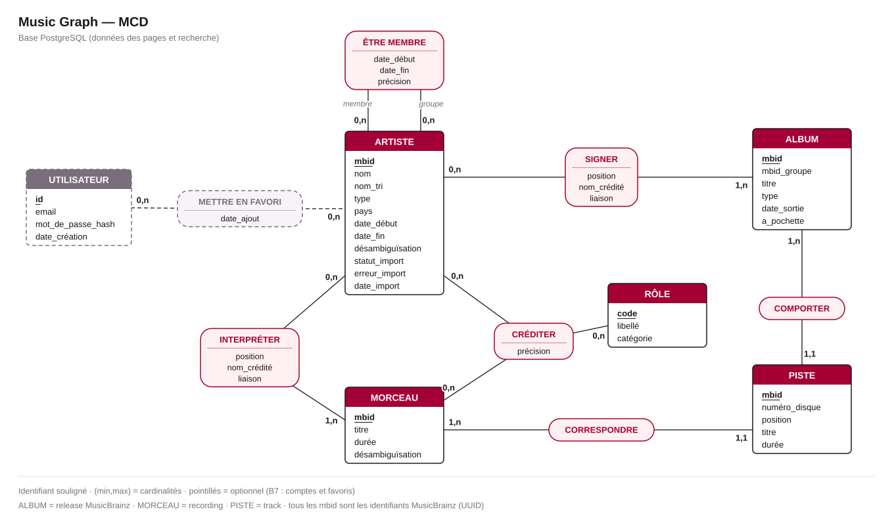

# Base PostgreSQL — MCD et MLD

PostgreSQL contient les données affichées dans les pages (B3) et utilisées par la recherche (B2). Le graphe des relations est dans ArangoDB ; les deux bases partagent le MBID comme clé.

## MCD

Vocabulaire MusicBrainz : **ALBUM** = _release_ (une édition précise d'un album, EP ou single), **MORCEAU** = _recording_ (un enregistrement), **PISTE** = _track_ (la place d'un enregistrement sur une release).

## Passage MCD → MLD

Règles de Merise appliquées :

| Cas dans le MCD                                                     | Traduction                                                       | Où                                                                                         |
| ------------------------------------------------------------------- | ---------------------------------------------------------------- | ------------------------------------------------------------------------------------------ |
| Entité                                                              | Table ; identifiant → clé primaire                               | `artists`, `releases`, `recordings`, `tracks`, `roles`, `users`                            |
| Association avec une patte (1,1)                                    | Clé étrangère dans la table côté (1,1)                           | COMPORTER → `tracks.release_mbid`, CORRESPONDRE → `tracks.recording_mbid`                  |
| Association (x,n)–(x,n)                                             | Table ; clé primaire = identifiants des entités liées            | SIGNER → `release_artists`, INTERPRÉTER → `recording_artists`, ÊTRE MEMBRE → `memberships`, METTRE EN FAVORI → `favorites` |
| Association ternaire                                                | Table ; clé primaire = les trois identifiants                    | CRÉDITER → `credits`                                                                       |

Les noms de tables et de colonnes sont en anglais, comme le code et les collections ArangoDB. Dans `schema.ts`, les propriétés seront en camelCase et les colonnes en snake_case, en nommant la colonne explicitement : `sortName: text("sort_name").notNull()`.

## MLD

Notation : clé primaire <ins>soulignée</ins>, clé étrangère précédée de `#`.

- **artists** (<ins>mbid</ins>, name, sort_name, type, country, begin_date, end_date, disambiguation, import_status, import_error, imported_at)
- **releases** (<ins>mbid</ins>, release_group_mbid, title, type, date, has_cover_art)
- **recordings** (<ins>mbid</ins>, title, length_ms, disambiguation)
- **tracks** (<ins>mbid</ins>, #release_mbid, #recording_mbid, disc_number, position, title, length_ms)
- **roles** (<ins>code</ins>, label, category)
- **release_artists** (<ins>#release_mbid, #artist_mbid</ins>, position, credited_name, join_phrase)
- **recording_artists** (<ins>#recording_mbid, #artist_mbid</ins>, position, credited_name, join_phrase)
- **credits** (<ins>#recording_mbid, #artist_mbid, #role_code</ins>, detail)
- **memberships** (<ins>#group_mbid, #member_mbid</ins>, begin_date, end_date, detail)
- **users** (<ins>id</ins>, email, password_hash, created_at) — _B7, optionnel_
- **favorites** (<ins>#user_id, #artist_mbid</ins>, created_at) — _B7, optionnel_

`memberships.group_mbid` et `memberships.member_mbid` référencent tous les deux `artists` (association réflexive).

## Détail des tables

Types PostgreSQL. « Null » = la colonne accepte NULL.

### artists

| Colonne          | Type            | Null | Contraintes / remarque                                                                    |
| ---------------- | --------------- | ---- | ----------------------------------------------------------------------------------------- |
| `mbid`           | `uuid`          | non  | PK                                                                                        |
| `name`           | `text`          | non  | index trigramme (recherche)                                                               |
| `sort_name`      | `text`          | non  | nom de tri (« Beatles, The »)                                                             |
| `type`           | `artist_type`   | oui  | inconnu pour certains artistes                                                            |
| `country`        | `char(2)`       | oui  | code ISO 3166-1 (`US`, `FR`)                                                              |
| `begin_date`     | `varchar(10)`   | oui  | date partielle, voir [Dates](#dates-partielles)                                           |
| `end_date`       | `varchar(10)`   | oui  | idem                                                                                      |
| `disambiguation` | `text`          | oui  | « US grunge band » : distingue les homonymes                                              |
| `import_status`  | `import_status` | oui  | `NULL` = artiste découvert via une relation, pas dans le corpus                           |
| `import_error`   | `text`          | oui  | message de la dernière erreur, `NULL` si `ok`                                             |
| `imported_at`    | `timestamptz`   | oui  | date de la dernière tentative d'import                                                    |

### releases

| Colonne              | Type           | Null | Contraintes / remarque                                                 |
| -------------------- | -------------- | ---- | ---------------------------------------------------------------------- |
| `mbid`               | `uuid`         | non  | PK ; sert aussi pour la pochette (Cover Art Archive)                   |
| `release_group_mbid` | `uuid`         | non  | **UNIQUE** : une seule édition par album                               |
| `title`              | `text`         | non  | index trigramme                                                        |
| `type`               | `release_type` | oui  | type principal du release group                                        |
| `date`               | `varchar(10)`  | oui  | date partielle                                                         |
| `has_cover_art`      | `boolean`      | non  | défaut `false` ; champ `cover-art-archive.front` de MusicBrainz        |

### recordings

| Colonne          | Type      | Null | Contraintes / remarque                    |
| ---------------- | --------- | ---- | ----------------------------------------- |
| `mbid`           | `uuid`    | non  | PK                                        |
| `title`          | `text`    | non  | index trigramme                           |
| `length_ms`      | `integer` | oui  | `CHECK (length_ms > 0)`                   |
| `disambiguation` | `text`    | oui  | « live », « radio edit »…                 |

### tracks

| Colonne          | Type       | Null | Contraintes / remarque                                 |
| ---------------- | ---------- | ---- | ------------------------------------------------------ |
| `mbid`           | `uuid`     | non  | PK (MBID de la piste)                                  |
| `release_mbid`   | `uuid`     | non  | FK → `releases`, `ON DELETE CASCADE`                   |
| `recording_mbid` | `uuid`     | non  | FK → `recordings` ; index                              |
| `disc_number`    | `smallint` | non  | `CHECK (disc_number >= 1)`                             |
| `position`       | `smallint` | non  | `CHECK (position >= 1)`                                |
| `title`          | `text`     | non  | titre imprimé sur l'album (peut différer du morceau)   |
| `length_ms`      | `integer`  | oui  | durée sur cette édition                                |

`UNIQUE (release_mbid, disc_number, position)` : deux pistes ne peuvent pas occuper la même place. Cette contrainte sert aussi d'index pour lire la tracklist dans l'ordre.

### roles

| Colonne    | Type            | Null | Contraintes / remarque                                                                    |
| ---------- | --------------- | ---- | ----------------------------------------------------------------------------------------- |
| `code`     | `varchar(32)`   | non  | PK ; nom du type de relation MusicBrainz, même valeur que `credited.role` dans ArangoDB   |
| `label`    | `text`          | non  | libellé affiché en français                                                               |
| `category` | `role_category` | non  | regroupement sur la page morceau (B3) et filtres du graphe (B6)                           |

Table de référence, remplie par une migration (voir [Rôles](#rôles-proposés)) et pas par l'import.

### release_artists et recording_artists

Même structure ; `release_mbid` est remplacé par `recording_mbid` dans `recording_artists`.

| Colonne         | Type       | Null | Contraintes / remarque                                                     |
| --------------- | ---------- | ---- | -------------------------------------------------------------------------- |
| `release_mbid`  | `uuid`     | non  | PK, FK → `releases`, `ON DELETE CASCADE`                                   |
| `artist_mbid`   | `uuid`     | non  | PK, FK → `artists` ; index                                                 |
| `position`      | `smallint` | non  | ordre dans le crédit ; `UNIQUE (release_mbid, position)`                   |
| `credited_name` | `text`     | non  | nom tel que crédité, peut différer de `artists.name` (ancien nom, graphie)  |
| `join_phrase`   | `text`     | non  | défaut `''` ; texte qui suit le nom : « & », « feat. »                     |

Le crédit affiché se reconstruit dans l'ordre de `position` : `credited_name` + `join_phrase` + … → « Kanye West feat. Jay-Z », avec un lien vers chaque artiste.

### credits

| Colonne          | Type          | Null | Contraintes / remarque                                                      |
| ---------------- | ------------- | ---- | --------------------------------------------------------------------------- |
| `recording_mbid` | `uuid`        | non  | PK, FK → `recordings`, `ON DELETE CASCADE`                                  |
| `artist_mbid`    | `uuid`        | non  | PK, FK → `artists` ; index                                                  |
| `role_code`      | `varchar(32)` | non  | PK, FK → `roles`                                                            |
| `detail`         | `text`        | oui  | attributs de la relation : « bass guitar », « lead vocals », « guest »…    |

### memberships

| Colonne       | Type          | Null | Contraintes / remarque              |
| ------------- | ------------- | ---- | ----------------------------------- |
| `group_mbid`  | `uuid`        | non  | PK, FK → `artists`                  |
| `member_mbid` | `uuid`        | non  | PK, FK → `artists` ; index          |
| `begin_date`  | `varchar(10)` | oui  | date partielle                      |
| `end_date`    | `varchar(10)` | oui  | date partielle                      |
| `detail`      | `text`        | oui  | instruments, voix                   |

`CHECK (group_mbid <> member_mbid)`.

### users (B7)

| Colonne         | Type          | Null | Contraintes / remarque                                      |
| --------------- | ------------- | ---- | ----------------------------------------------------------- |
| `id`            | `uuid`        | non  | PK, défaut `uuidv7()` (fonction native de PostgreSQL 18)    |
| `email`         | `text`        | non  | index UNIQUE sur `lower(email)`                             |
| `password_hash` | `text`        | non  | hash (argon2 ou bcrypt), jamais le mot de passe             |
| `created_at`    | `timestamptz` | non  | défaut `now()`                                              |

### favorites (B7)

| Colonne       | Type          | Null | Contraintes / remarque                      |
| ------------- | ------------- | ---- | ------------------------------------------- |
| `user_id`     | `uuid`        | non  | PK, FK → `users`, `ON DELETE CASCADE`       |
| `artist_mbid` | `uuid`        | non  | PK, FK → `artists`                          |
| `created_at`  | `timestamptz` | non  | défaut `now()`                              |

## Types énumérés

| Type            | Valeurs                                                           |
| --------------- | ----------------------------------------------------------------- |
| `artist_type`   | `person`, `group`, `orchestra`, `choir`, `character`, `other`     |
| `release_type`  | `album`, `ep`, `single`, `broadcast`, `other`                     |
| `import_status` | `pending`, `ok`, `failed`                                         |
| `role_category` | `performance`, `production`, `engineering`, `writing`             |

Les valeurs reprennent celles de MusicBrainz, en minuscules. `pending` = import commencé mais pas terminé (interruption) : l'artiste est repris au prochain lancement.

## Rôles proposés

| `code`        | `label`          | `category`    |
| ------------- | ---------------- | ------------- |
| `performer`   | Interprète       | `performance` |
| `vocal`       | Chant            | `performance` |
| `instrument`  | Instrument       | `performance` |
| `producer`    | Production       | `production`  |
| `programming` | Programmation    | `production`  |
| `arranger`    | Arrangement      | `production`  |
| `remixer`     | Remix            | `production`  |
| `engineer`    | Ingénieur du son | `engineering` |
| `recording`   | Prise de son     | `engineering` |
| `mix`         | Mixage           | `engineering` |
| `mastering`   | Mastering        | `engineering` |
| `composer`    | Composition      | `writing`     |
| `lyricist`    | Paroles          | `writing`     |
| `writer`      | Écriture         | `writing`     |

L'import ignore les types de relation absents de cette table. Pour en ajouter un, il faut une ligne de plus ici, pas une modification du schéma. `composer`, `lyricist` et `writer` sont des relations de l'œuvre (_work_) chez MusicBrainz : il faudra les rattacher au morceau lors de l'import.

## Index

- Les clés primaires et les contraintes UNIQUE créent déjà un index.
- PostgreSQL n'indexe pas automatiquement les clés étrangères. On en ajoute un sur celles qui ne sont pas en tête d'une clé primaire ou d'une contrainte UNIQUE : `tracks(recording_mbid)`, `release_artists(artist_mbid)`, `recording_artists(artist_mbid)`, `credits(artist_mbid)`, `memberships(member_mbid)`. Ils servent aux pages artiste (albums, morceaux, groupes) et morceau (albums qui le contiennent).
- Recherche (B2) : index GIN trigramme sur `artists.name`, `releases.title` et `recordings.title`. Il accélère `ILIKE '%terme%'` et tolère les fautes de frappe avec `similarity()`. Il nécessite l'extension `pg_trgm` (`CREATE EXTENSION IF NOT EXISTS pg_trgm;` dans une migration personnalisée). En Drizzle : `index().using("gin", t.name.op("gin_trgm_ops"))`.

## Choix de conception

### MBID comme clé primaire

Pas de clé artificielle (`serial`). Le MBID est stable et fourni par la source. C'est aussi la clé commune avec ArangoDB (`_key`), et l'import fait un `INSERT … ON CONFLICT (mbid) DO UPDATE` : relancer l'import ne crée pas de doublon (B1). Le type `uuid` prend 16 octets au lieu de 36 caractères et refuse une valeur mal formée.

### Dates partielles

MusicBrainz donne souvent des dates incomplètes : « 1991 », « 1991-09 ». Le type `date` obligerait à inventer un jour et un mois. On garde donc la chaîne ISO dans `varchar(10)` avec `CHECK (col ~ '^\d{4}(-\d{2}(-\d{2})?)?$')`. L'ordre alphabétique de ces chaînes est aussi l'ordre chronologique : on peut faire `ORDER BY date`.

### Une seule édition par album

Un album a souvent des dizaines d'éditions (pays, formats, rééditions). Toutes les importer afficherait 15 fois le même album sur la page artiste. L'import garde une seule release par release group (par exemple la première édition officielle), et `UNIQUE (release_group_mbid)` le garantit. On stocke la release et pas seulement le release group parce que la tracklist et la pochette dépendent d'une édition précise.

### PISTE distincte de MORCEAU

Un même enregistrement apparaît sur plusieurs albums (album original, compilation). Le titre imprimé, la durée et la position appartiennent à la piste, pas au morceau. Identifier la piste par son propre MBID gère aussi le cas rare d'un morceau présent deux fois sur la même release.

### Deux sortes de crédits

MusicBrainz sépare deux informations, le schéma aussi :

- le **crédit d'artiste** (SIGNER, INTERPRÉTER) : qui signe l'album ou le morceau, tel qu'écrit sur la pochette (« Kanye West feat. Jay-Z ») ;
- les **relations** (CRÉDITER) : qui a produit, joué, mixé, écrit.

Le featuring n'est pas un rôle MusicBrainz : il se lit dans `join_phrase` (« feat. »). L'import le transforme en arête `credited` de rôle `featuring` dans ArangoDB, pour le filtre B6.

### CRÉDITER est ternaire

Un artiste peut avoir plusieurs rôles sur le même morceau (producteur et chanteur). Le rôle doit donc faire partie de l'identifiant de l'association, d'où l'entité RÔLE. Une table plutôt qu'un simple enum, parce qu'un rôle a un libellé français et une catégorie.

### Statut d'import sur l'artiste

Seuls les ~100 artistes du corpus sont importés en entier (albums, pistes, crédits). Les autres (un producteur, un membre de groupe) sont créés avec les seules informations fournies par la relation, et `import_status` reste `NULL`. Rejouer les échecs revient à prendre les artistes du corpus dont le statut n'est pas `ok`, ou qui n'ont pas encore de ligne parce que le tout premier appel a échoué. Le script compare donc sa liste du corpus avec la table.

### ÊTRE MEMBRE identifié par (groupe, membre)

C'est une simplification : un musicien qui quitte puis rejoint un groupe n'a qu'une ligne. On garde la première date de début et la dernière date de fin.

### Rien de déductible n'est stocké (3FN)

Il n'y a ni colonne « crédit affiché » (reconstruit depuis `release_artists`), ni URL de pochette : elle se déduit du MBID, `https://coverartarchive.org/release/{mbid}/front-250` si `has_cover_art`. `credited_name` et `tracks.title` ne sont pas des doublons : ils peuvent différer du nom de l'artiste et du titre du morceau. `detail` est un texte libre affiché tel quel et jamais filtré, il reste donc atomique pour la base.

### Suppressions en cascade

`ON DELETE CASCADE` part seulement de l'entité « propriétaire » vers ses associations : release → `tracks` et `release_artists`, recording → `credits` et `recording_artists`, user → `favorites`. L'import peut ainsi remplacer les associations d'un album, dans une transaction, sans laisser de lignes orphelines. Vers `artists`, on garde le comportement par défaut (refus) : un artiste est référencé de partout et ne doit pas disparaître par effet de bord.

## Correspondance avec ArangoDB

| PostgreSQL                      | ArangoDB                                                                   |
| ------------------------------- | -------------------------------------------------------------------------- |
| `artists.mbid`                  | `artists/_key`                                                             |
| `releases.mbid`                 | `releases/_key`                                                            |
| `recordings.mbid`               | `recordings/_key`                                                          |
| `tracks`                        | arêtes `contains` (release → recording)                                    |
| `credits`, `recording_artists`  | arêtes `credited` (artist → recording) ; `role` = `roles.code`, `main` ou `featuring` |
| `memberships`                   | arêtes `member_of` (membre → groupe)                                       |

## Points à trancher avant l'import

- **Types de releases importés** : album et EP (proposé) ; les singles ajoutent surtout des doublons de morceaux.
- **Crédits au niveau de l'album** : sur MusicBrainz, le producteur est souvent crédité sur la release entière plutôt que sur chaque morceau. Soit on les recopie sur chaque morceau dans `credits` (plus de liens dans le graphe), soit on les ignore.
- **B7** : une bibliothèque d'authentification (Better Auth, Auth.js…) impose ses propres tables (`user`, `session`…). Dans ce cas, `users` disparaît et `favorites.user_id` référence la table de la bibliothèque.
