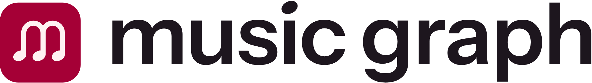

# Music Graph : logo

<picture>
  <source media="(prefers-color-scheme: dark)" srcset="png/music-graph-logo-fond-sombre.png">
  
</picture>

Concept « Liaisons » : le **m** de *music* est formé de **trois notes** reliées par **deux arcs**. En solfège,
ces arcs sont des **liaisons** ; en théorie des graphes, ce sont des **arêtes** entre trois nœuds, ici trois
artistes. Une seule forme se lit donc de trois façons : une lettre, de la musique, un graphe.

## 1. Quel fichier utiliser ?

| Besoin | Fichier |
| --- | --- |
| En-tête du site (React) | `web/components/music-graph-logo.tsx` → `<MusicGraphLogo />`, `<MusicGraphIcon />` |
| Logo principal, fond clair | `svg/music-graph-logo.svg` |
| Logo principal, fond sombre (`#1d161e`) | `svg/music-graph-logo-fond-sombre.svg` |
| Logo vertical (format carré, page de titre) | `svg/music-graph-logo-vertical.svg`, `…-vertical-fond-sombre.svg` |
| Logo sans tuile (impression, une couleur) | `svg/music-graph-logo-sans-tuile.svg`, `…-sans-tuile-fond-sombre.svg`, `…-noir.svg`, `…-blanc.svg` |
| Icône seule (avatar, profil, application) | `svg/music-graph-tuile.svg` (`…-tuile-noir.svg` pour l'impression noir et blanc) |
| Symbole seul | `svg/music-graph-symbole.svg`, `…-fond-sombre.svg`, `…-noir.svg`, `…-blanc.svg` ; `…-petit.svg` sous 48 px |
| Texte seul | `svg/music-graph-logotype.svg`, `…-logotype-fond-sombre.svg` |
| Word, PowerPoint, documents | `png/` (fond transparent) |
| Présentation finale | `presentation/slides/*.png`, `presentation/music-graph-presentation.html` |

Les fichiers `…-fond-sombre` et `…-blanc` sont légèrement affinés (voir § 6) : ne pas les remplacer par une
simple inversion de couleur.

## 2. Intégration dans le site (Next.js 16)

`web/` reproduit l'arborescence du projet. Depuis la racine du projet :

```bash
cp logo/web/app/* app/          # remplace app/favicon.ico (l'icône par défaut de Next.js)
mkdir -p public/icons && cp logo/web/public/icons/* public/icons/
cp logo/web/components/music-graph-logo.tsx components/
```

Next.js ajoute lui-même les balises du `<head>` d'après le nom des fichiers placés dans `app/`
(voir `node_modules/next/dist/docs/01-app/03-api-reference/03-file-conventions/01-metadata/`) :

| Fichier dans `app/` | Rôle |
| --- | --- |
| `favicon.ico` | favicon 16, 32 et 48 px, dessiné spécialement pour les petites tailles |
| `icon.svg` | favicon vectoriel, utilisé par les navigateurs récents |
| `apple-icon.png` | icône d'écran d'accueil iPhone et iPad (180 px) |
| `manifest.ts` | manifest de l'application web ; ses icônes sont dans `public/icons/` |
| `opengraph-image.png` et `.alt.txt` | image affichée quand on partage un lien (1200 × 630) |

Dans l'en-tête du site :

```tsx
import Link from "next/link"

import { MusicGraphLogo } from "@/components/music-graph-logo"

export function SiteHeader() {
  return (
    <header className="flex h-14 items-center px-6">
      <Link href="/">
        <MusicGraphLogo className="h-7 text-foreground" />
      </Link>
    </header>
  )
}
```

- `MusicGraphLogo` : logo horizontal. La tuile garde ses couleurs ; le texte est en `currentColor`, il prend
  donc la couleur du texte du thème et passe tout seul du clair au sombre. Hauteur conseillée : `h-7` à `h-9`.
- `MusicGraphIcon` : la tuile seule (`size-8` par défaut), par exemple pour l'en-tête sur mobile.

Facultatif, dans `app/layout.tsx` (titre de l'onglet et description pour les moteurs de recherche) :

```tsx
import type { Metadata } from "next"

export const metadata: Metadata = {
  title: "Music Graph",
  description:
    "Explorer les liens entre artistes et trouver le plus court chemin entre deux artistes.",
}
```

Une fois le site en ligne, ajouter `metadataBase: new URL("https://…")` pour que l'adresse de l'image de
partage soit absolue.

## 3. Couleurs

| Nom | Rôle | HEX | RGB | OKLCH (thème) | CMJN * |
| --- | --- | --- | --- | --- | --- |
| Cramoisi | couleur principale : tuile, symbole sur fond clair | `#A50036` | 165 0 54 | `oklch(0.455 0.188 13.697)` | 0 100 67 35 |
| Aubergine | fond sombre, texte sur fond clair | `#1D161E` | 29 22 30 | `oklch(0.212 0.019 322.12)` | 3 27 0 88 |
| Rose clair | m sur la tuile, texte sur fond sombre | `#FFF1F2` | 255 241 242 | `oklch(0.969 0.015 12.422)` | 0 5 5 0 |

\* Conversion simple, à faire valider par un imprimeur. Pantone le plus proche du cramoisi : environ 207 C,
à vérifier sur un nuancier.

Ces couleurs existent déjà dans `app/globals.css` : le cramoisi est `--primary` en mode sombre, l'aubergine
est `--card` en mode sombre, et le rose clair est `--primary-foreground`.

| Paire | Contraste | |
| --- | --- | --- |
| Cramoisi sur blanc | 7,9 : 1 | ✅ |
| Rose clair sur cramoisi (la tuile) | 7,2 : 1 | ✅ |
| Rose clair sur aubergine | 16,1 : 1 | ✅ |
| Aubergine sur blanc | 17,7 : 1 | ✅ |
| **Cramoisi sur aubergine** | **2,2 : 1** | ❌ trop sombre : sur fond sombre, utiliser la tuile ou le rose clair |

## 4. Polices

| Police | Usage | Où elle est configurée |
| --- | --- | --- |
| **Instrument Sans** | logotype (SemiBold 600, vectorisé) et tout le texte du site | `Instrument_Sans` dans `app/layout.tsx` → variable `--font-sans` |
| **Geist Mono** | identifiants MBID, requêtes AQL, données techniques | `Geist_Mono` dans `app/layout.tsx` → `--font-mono` (classe `font-mono`) |

- Graisses conseillées : 400 pour le texte courant (`font-normal`), 500 pour les boutons et libellés
  (`font-medium`), 600 pour les titres (`font-semibold`).
- Les deux polices sont sous licence libre SIL Open Font License 1.1 et sont auto-hébergées par `next/font` :
  il n'y a rien à installer.
- Le logo n'a pas besoin de la police, car son texte est vectorisé. Ne pas retaper « music graph » dans une
  police : le logotype est retouché (approche resserrée, point du i en tête de note).
- `Geist` est importé dans `app/layout.tsx` sans être utilisé ; cet import peut être supprimé.

## 5. Règles d'usage

- **Zone de protection** : laisser autour du logo un espace libre au moins égal à la moitié de la hauteur de
  la tuile. Autour de la tuile seule : un quart de sa largeur.
- **Tailles minimales à l'écran** : logo horizontal 160 px de large, logo vertical 100 px, tuile 24 px.
  En dessous, utiliser `web/app/icon.svg` (favicon), dessiné pour 16 à 48 px.
- **Fonds** : sur fond clair, `music-graph-logo.svg` ; sur fond sombre, `…-fond-sombre.svg` ; sur une photo ou
  un fond chargé, une version avec tuile, qui sert de cadre.
- **À ne pas faire** :
  - déformer ou faire pivoter le logo ;
  - changer les couleurs, en particulier mettre le m cramoisi sur fond sombre ;
  - ajouter une ombre, un contour ou un dégradé ;
  - modifier l'écart entre la tuile et le texte ;
  - retaper le texte dans une police.

## 6. Construction (pour justifier les choix)

- **Une seule unité.** Tout découle de l'épaisseur du trait W = 20 : écart entre les hampes 72 (3,6 W), arcs
  en demi-cercles de rayon 36, hampes de 82 (4,1 W).
- **Têtes de note.** Ce sont des ellipses de 26 × 19 (rapport 1,37), inclinées à 25°. Chacune est placée à
  gauche de sa hampe, comme une note à hampe montante sur une partition.
- **Corrections optiques :**
  - Les versions claires sur fond sombre ont un trait 4 % plus fin et un texte en graisse 585 au lieu de 600,
    parce qu'un élément clair sur fond foncé paraît plus gras (irradiation).
  - Une coupe « petite taille » sert au favicon : trait épaissi (W = 28) et m plus compact, pour rester lisible
    à 16 px.
  - Le m est centré optiquement dans la tuile : on vise le milieu entre son centre géométrique et son centre de
    masse, puis on remonte de 1,5 %.
- **Logotype.** Instrument Sans SemiBold, avec le crénage de la police, une approche resserrée (−12/1000 em)
  et un espace entre les mots réduit (165/1000 em). Le point carré du i est remplacé par une tête de note
  inclinée comme celles du symbole.
- **Assemblages.** Dans le logo horizontal, la tuile va de la ligne des ascendantes à celle des descendantes du
  texte, avec un écart de 0,30 em. Dans le logo vertical, la tuile est deux fois plus haute et posée 0,40 em
  au-dessus du texte.
- **Tests effectués :**
  - lisibilité de 16 à 256 px ;
  - versions une couleur et inversée, flou, miroir, rotation ;
  - comparaison avec les logos du secteur : TikTok, Spotify, SoundCloud, Tidal, Last.fm, Neo4j, ArangoDB et
    Multipass ;
  - audit SVG : 98 à 100/100, sans texte non vectorisé, image intégrée ni filtre.

  Les étapes de recherche sont dans `processus/`.

## 7. Régénérer les fichiers

Tous les SVG, `web/app/icon.svg` et le composant React sont produits par `src/build_logo.py`. La géométrie y
est calculée ; aucun fichier n'est retouché à la main.

```bash
pip install fonttools brotli uharfbuzz
python logo/src/build_logo.py   # trouve Instrument Sans dans .next/ : lancer `npm run dev` une fois avant
```

Les PNG et le favicon.ico doivent être réexportés après une modification, avec n'importe quel outil qui
convertit du SVG (Inkscape, Figma, navigateur…) :

| Sortie | Source | Taille |
| --- | --- | --- |
| `web/app/favicon.ico` | `src/raster/favicon-16.svg` (16 px), `src/raster/favicon-32.svg` (32 et 48 px) | 16, 32, 48 |
| `web/app/apple-icon.png` | `src/raster/apple-icon.svg` | 180 × 180 |
| `web/public/icons/icon-192.png`, `icon-512.png` | `src/raster/icon.svg` | 192, 512 |
| `web/public/icons/icon-maskable-512.png` | `src/raster/icon-maskable.svg` | 512 |
| `web/app/opengraph-image.png` | `src/raster/opengraph-image.svg` | 1200 × 630 |
| `png/*.png` | `svg/*.svg` correspondant | 1024 à 2000 px de large |

`src/presentation.json` décrit la planche de présentation (générée avec le skill logo-design).

## 8. Contenu du dossier

```
logo/
├── README.md            ce guide
├── svg/                 fichiers maîtres vectoriels (17 versions)
├── png/                 exports transparents pour documents et présentations
├── web/                 fichiers prêts à copier dans le projet Next.js
│   ├── app/             favicon.ico, icon.svg, apple-icon.png, manifest.ts, opengraph-image.png
│   ├── public/icons/    icônes du manifest (192, 512, maskable)
│   └── components/      music-graph-logo.tsx
├── presentation/        planche de présentation (HTML + diapositives PNG)
├── processus/           recherche : comparaison des 3 concepts, itérations du concept retenu
└── src/                 build_logo.py, sources des images (raster/), presentation.json
```
